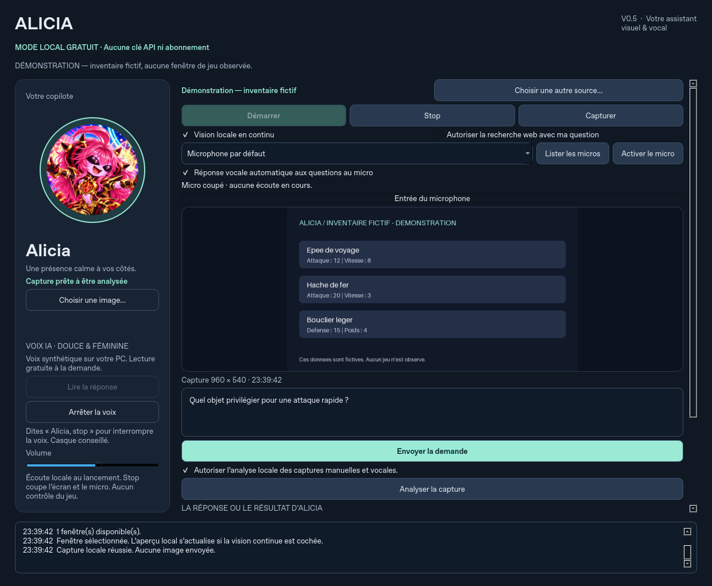

# Alicia

Assistant IA gratuit pour Windows : Alicia répond aux questions sur l’écran et exécute des consignes naturelles, à l’oral ou à l’écrit. Le lancement normal active l’observation et le microphone, avec un état visible et un bouton Stop. Alicia ne génère aucune touche ni aucun clic dans le jeu.

La v0.5 ajoute un premier catalogue d’actions aux moteurs locaux existants : **Ollama avec Qwen3-VL 8B**, **Whisper large-v3-turbo multilingue** et **Chatterbox Multilingual**. Aucun compte, clé API ou abonnement n’est nécessaire. La qualité et la vitesse restent à évaluer sur votre PC ; Alicia n’est pas cette conversation ChatGPT.



## Installer ou mettre à jour

1. Fermer l’ancienne Alicia et extraire complètement la nouvelle archive.
2. Double-cliquer sur **Installer_Alicia.bat** et attendre la fin des téléchargements. La fenêtre se ferme après réussite ; une erreur reste visible.
3. Utiliser le raccourci **Alicia** du Bureau ou **Lancer_Alicia.vbs** pour un lancement sans terminal.

**Lancer_Alicia.bat** reste compatible et appelle le lancement masqué ; il peut afficher brièvement une console. Une boîte de dialogue signale les erreurs du lanceur masqué. **Lancer_Alicia_Debug.bat** garde une console pour le diagnostic.

Le lancement masqué garde la fenêtre d’Alicia visible : seuls ses processus de console sont cachés. L’aperçu automatique laisse les boutons stables ; une demande envoyée pendant sa capture attend sa fin avant d’être traitée.

L’installateur conserve votre `.env`, prépare les dépendances verrouillées et télécharge explicitement les modèles. Chatterbox dispose d’un environnement Python séparé. Prévoir plusieurs Go pour les modèles et leurs dépendances, et un premier chargement plus lent. Le lancement et les questions ne téléchargent aucun modèle. Voir [Installation gratuite](docs/INSTALLATION_GRATUITE.md), notamment pour choisir explicitement la voix Kokoro plus légère.

## Donner une consigne à Alicia

Dire « Alicia » suivi de la demande, ou écrire celle-ci puis cliquer sur **Envoyer la demande**. Il n’est pas nécessaire de la formuler comme une question. Les actions écrites restent utilisables quand l’observation est arrêtée.

| Exemple | Action disponible |
| --- | --- |
| « Alicia, cherche un guide de guerrier sur WoW Forever. » | Rechercher sur le web et ouvrir une réponse accompagnée de ses sources. |
| « Alicia, ouvre la calculatrice. » | Ouvrir une application du catalogue. |
| « Alicia, ouvre mes téléchargements. » | Ouvrir un dossier personnel connu. |
| « Alicia, prends une note : acheter des potions. » | Créer une note locale et afficher son emplacement. |

Le catalogue initial comprend Bloc-notes, Calculatrice, Paint, Explorateur de fichiers, le navigateur, les dossiers Bureau/Documents/Téléchargements/personnel, les pages web publiques et les notes `.txt` ou `.md`. Une demande hors de ce catalogue est signalée ; Alicia ne peut pas exécuter n’importe quelle commande Windows. Le même parcours traite les consignes vocales et écrites. Les actions ne demandent pas de capture d’écran.

Une demande explicite de recherche autorise l’envoi de cette requête au moteur, même si la case de recherche des questions ordinaires reste décochée. Elle n’envoie ni image ni audio. Le navigateur affiche une synthèse locale à partir des extraits trouvés, avec les sources et leurs liens ; les pages complètes ne sont pas lues. Si la synthèse est indisponible, le compte rendu conserve les résultats. Si le moteur de recherche est indisponible, Alicia peut ouvrir la requête dans le navigateur en indiquant qu’aucune source n’a été vérifiée.

## Poser une question sur l’écran

Passez dans votre jeu ou votre navigateur sur l’écran principal, puis dites par exemple :

> « Alicia, décris ce que tu vois. »
>
> « Alicia, lequel de ces objets semble le plus adapté, et pourquoi ? »

Laissez un silence en fin de demande. Dire seulement « Alicia » ouvre une fenêtre de huit secondes pour la phrase suivante. Les conversations sans ce mot d’activation ne déclenchent aucune demande. Pour une question sur l’écran, Alicia prend une capture fraîche, utilise le contexte court de la session, affiche sa réponse puis la lit.

**« Alicia, stop »** demande de couper la voix pendant la lecture et de revenir à l’écoute. **Stop**, dans l’interface, coupe l’observation et le microphone, annule les actions encore en attente et efface le contexte ; **Reprendre** relance observation et écoute. Une page déjà ouverte ou une note déjà créée reste accessible. La détection vocale demande un délai de reconnaissance et doit être testée avec votre micro. Un casque aide à éviter que le son des haut-parleurs revienne dans le micro.

L’écoute ordinaire se suspend pendant le traitement. Pendant la lecture, seules les commandes d’interruption sont prises en compte. Les protections contre l’écho ne constituent pas une annulation d’écho complète.

L’aperçu se met à jour environ chaque seconde, sans analyse IA de chaque image. Alicia voit tout le contenu visible de l’écran principal : minimisez sa fenêtre pour lui montrer le jeu. Une autre source reste accessible dans les options avancées.

Une question écrite sur l’écran demande une observation active et l’autorisation d’analyse ; **Envoyer la demande** prend alors une capture fraîche. **Analyser la capture** conserve le parcours manuel sur une capture choisie. Les résultats des consignes vocales sont lus lorsque la réponse vocale automatique est cochée ; une demande écrite n’impose pas de lecture.

## Voix, reconnaissance et réponses

Chatterbox produit du français localement à partir d’une référence féminine synthétique fournie avec l’application. Cette référence vient de Kokoro ; aucune voix de personne réelle n’est clonée. Le rendu Chatterbox doit être écouté sur votre sortie audio avant de le qualifier de plus naturel. Le volume est réglable et l’avatar s’anime pendant la lecture réelle. L’image fournie pour Alicia sert d’icône arrondie et de portrait par défaut.

L’[extrait audio fourni](examples/voix-francaise.wav) est un **exemple Kokoro**, généré réellement lors de la v0.3 ; il ne démontre pas le rendu Chatterbox.

Whisper large-v3-turbo remplace les poids small précédents. Le français reste imposé et les transcriptions peu fiables doivent être rejetées plutôt que transformées en mots inventés. Les noms propres, accents et bruits du jeu restent à tester. La carte graphique est utilisée si l’initialisation CUDA réussit ; le mode automatique peut revenir au CPU, plus lent.

Au démarrage, l’interface distingue le chargement du modèle de l’écoute réellement prête. Attendre **En attente de « Alicia »** avant de parler ; la jauge **Entrée du microphone** permet ensuite de vérifier que le son arrive. Stop puis Reprendre n’empilent pas plusieurs chargements de reconnaissance. La détection des phrases peu fortes a été ajustée ; sa précision doit encore être vérifiée avec votre micro.

Les réponses privilégient les faits visibles, un conseil court et sa justification utile. L’historique aide les questions de suivi, mais l’écran actuel prime. Si « celui-là » reste ambigu ou qu’un texte est illisible, Alicia doit demander une précision. Le modèle visuel reste chargé quinze minutes après utilisation pour limiter les rechargements ; aucun gain de vitesse mesuré n’est promis.

## Recherche web et données

La case **Autoriser la recherche web** est désactivée par défaut pour les questions ordinaires. Une consigne explicite comme « cherche… » autorise la recherche de cette demande. Seule la requête est envoyée au moteur, sans capture ni audio. Les extraits, liens et dates de récupération sont affichés ; les pages complètes ne sont pas lues par ce premier adaptateur. Une date de récupération n’est pas une date de publication.

Les captures, le contexte court et l’audio du micro restent locaux dans le parcours gratuit. Les notes et comptes rendus HTML créés sur demande sont conservés sous `%LOCALAPPDATA%/Alicia/notes`, sans écraser de fichier existant. Un compte rendu contient la requête, la réponse éventuelle et les extraits des sources ; ces fichiers restent jusqu’à leur suppression manuelle. Les logs tournants, sous `%LOCALAPPDATA%/Alicia/logs`, ne contiennent ni capture, ni demande, ni transcription, ni réponse, ni audio. Stop ou un changement de source efface le contexte en mémoire et conserve les fichiers déjà créés. Aucun service payant ne remplace silencieusement un moteur local absent.

## Vérifier le développement

Depuis la racine :

```powershell
uv sync --python 3.12 --frozen --extra dev
uv run --frozen ruff check src tests
uv run --frozen ruff format --check src tests
uv run --frozen pytest -q
uv run --frozen alicia --smoke-test
```

La démonstration `uv run --frozen alicia --demo` utilise une image fictive, ne démarre pas automatiquement le microphone et bloque les ouvertures ou créations réelles. Le smoke test n’exécute ni périphérique, ni modèle ou recherche réels. Les tests avec doubles ne remplacent pas les essais Windows décrits dans [Validation Windows](docs/VALIDATION_WINDOWS.md).

Vérifications v0.5 : **751 tests Python réussis**, smoke test graphique sans appel IA, paquet construit avec ses ressources et **11 scénarios/154 assertions PowerShell**. Les tests d’intégration créent réellement une note et un compte rendu HTML dans des répertoires temporaires ; le navigateur, les applications et le modèle sont remplacés par des doubles. Le test web réel du cloud a préparé le repli vers le navigateur, sans ouvrir celui-ci.

Le moteur CPU Chatterbox a été installé et importé réellement ; son tokenizer français et le watermark fourni ont été vérifiés avec les accès réseau interdits. Ces vérifications ne produisent pas de parole Chatterbox.

La synthèse Kokoro a été exécutée réellement dans le cloud. Les téléchargements Hugging Face de Whisper et Chatterbox y sont refusés par le réseau (403) : leur transcription et synthèse réelles, la capture de l’écran principal, le microphone, l’interruption et le rendu audio Windows restent à valider sur le PC cible. L’ouverture native du navigateur, des applications et dossiers Windows demande également les essais de la procédure dédiée.

## Documents

- [Installation gratuite](docs/INSTALLATION_GRATUITE.md).
- [Prompt complet Alicia](docs/PROMPT_PROJET_ALICIA.md).
- [Architecture](docs/architecture-v0.1.md).
- [Feuille de route](docs/ROADMAP.md).
- [Validation Windows](docs/VALIDATION_WINDOWS.md).
