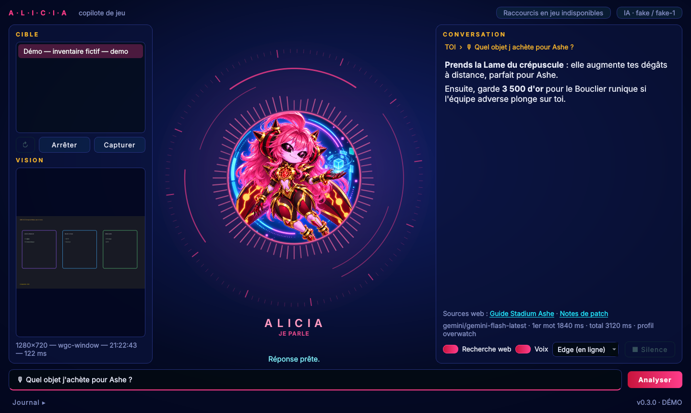

# Alicia — copilote IA pour jeux vidéo (Windows)

Alicia regarde la fenêtre de ton jeu, et quand tu lui poses une question, elle analyse la capture et te répond en quelques secondes. **Elle observe et conseille seulement** : aucun clic, aucune touche, aucune injection dans le jeu, aucune lecture de sa mémoire.



**Version 0.3** : capture d'une fenêtre (même en plein écran), question écrite (F9) ou orale (F10 maintenu), recherche web, réponse affichée mot par mot et lue à voix haute, logs détaillés. La capture automatique, la mémoire de session et les interventions spontanées arrivent dans les versions suivantes ([feuille de route](docs/architecture.md#feuille-de-route)).

## Installer (une seule fois)

1. Récupérer le projet : `git clone https://github.com/byRedemptiion/ALICIA_COPILOTE` (ou **Code → Download ZIP** sur GitHub, puis décompresser).
2. Créer une **clé Gemini gratuite** : <https://aistudio.google.com> → **Get API key** → **Create API key**. Aucune carte bancaire n'est demandée.
3. Double-cliquer sur **`Installer_Alicia.bat`**. Le script :
   - installe uv (gestionnaire Python), Python 3.12 et les dépendances ;
   - te demande la clé et l'enregistre dans `.env` (fichier exclu de Git) ;
   - vérifie la clé et teste l'interface.

## Lancer

Double-cliquer sur **`Lancer_Alicia.bat`**.

1. Dans **Fenêtre du jeu**, choisir le jeu (ex. `Overwatch — Overwatch.exe [plein écran]`), puis **Démarrer**.
2. Taper une question, puis **Entrée** ou **Analyser** : Alicia capture l'écran et répond. **Capturer** permet de vérifier l'aperçu sans appeler l'IA.
3. Le **Journal** en bas affiche chaque étape : backend de capture, durée, temps avant le premier mot, erreurs.

Pour essayer sans jeu : `Lancer_Alicia.bat --demo` (inventaire fictif, clairement signalé).

### Mode bulle : seule ALICIA à l'écran

Au lancement, **seul le rond d'ALICIA s'affiche**, en haut à droite, toujours au-dessus des autres fenêtres. Ses réponses apparaissent dans une bulle à côté **uniquement pendant un échange**, puis s'effacent toutes seules. La bulle laisse passer les clics vers le jeu, et ni le rond ni la bulle n'apparaissent dans les captures envoyées à l'IA.

- **Glisser** le rond pour le déplacer (la position est retenue) ; **double-clic** = panneau complet ; **clic droit** = menu (couper la voix, quitter…).
- Dans le panneau complet, le bouton **◉ Mode bulle** y revient.
- Pour voir le rond par-dessus le jeu, règle le jeu en **plein écran fenêtré** (« sans bordure »). En plein écran exclusif, le jeu passe devant : F9, F10 et la voix marchent quand même.
- Pour démarrer sur le panneau complet : `mode = "full"` dans la section `[ui]` de `alicia.toml`.

### Parler à Alicia : F10 (maintenir)

**Maintiens F10 en jeu, pose ta question à voix haute, relâche.** Alicia capture l'écran, envoie ta voix et l'image à Gemini, affiche ta question transcrite puis **répond à voix haute**. Pour la couper, réappuie sur F10 ou clique sur « Couper la voix ».

- **Ta voix est comprise sur ton PC** par faster-whisper (modèle `large-v3-turbo`, sur le processeur : gratuit, privé, n'utilise pas la carte graphique du jeu). Plus rapide mais moins précis : `[voice] whisper_model = "small"`. Pour revenir à l'envoi direct de l'audio à Gemini : `[voice] stt = "gemini"`.
- **Deux voix pour Alicia, au choix dans le menu à côté de « Réponse vocale »** : Edge (voix Microsoft `fr-FR-DeniseNeural`, gratuite, en ligne) ou Kokoro (voix française `ff_siwis`, locale et hors ligne, calculée sur le processeur). Autres voix Edge : `uv run alicia-diag voices`.
- Les modèles locaux (Whisper ≈ 800 Mo, Kokoro ≈ 340 Mo) sont téléchargés une seule fois à l'installation, dans `%LOCALAPPDATA%\Alicia\models`.
- Micro ou haut-parleur précis : `uv run alicia-diag devices`, puis `[voice] input_device` / `output_device` (une partie du nom suffit).
- Tester sans jeu : `uv run alicia-diag record` (micro), `uv run alicia-diag transcribe micro.wav` (compréhension) et `uv run alicia-diag say --engine kokoro` (voix).
- Le micro n'est ouvert que pendant que tu maintiens F10 : rien n'est écouté en dehors, et aucun enregistrement n'est gardé sur le disque.

### Actions sur le PC (comme un Jarvis)

Avec **F10** ou à l'écrit, Alicia exécute certaines demandes **sur Windows, jamais dans le jeu** :

| Exemple | Action | Sécurité |
| --- | --- | --- |
| « Monte le son », « baisse le volume de 20 », « volume à 30 », « coupe le son » | Volume | immédiat |
| « Lance Discord », « ouvre Spotify » | Applis de la liste `[actions.apps]` | immédiat |
| « Rappelle-moi dans 20 minutes de manger », « minuteur de 5 minutes » | Rappel dit à voix haute | immédiat |
| « Verrouille le PC », « mets le PC en veille », « ferme Discord » | Session, veille, fermeture d'appli | **confirmation** (« oui » / « non ») |
| « Éteins le PC », « redémarre le PC » | Extinction / redémarrage | **confirmation + 60 s**, « annule » l'arrête |

- Les demandes sont reconnues **sur ton PC, sans IA** (instantané, gratuit, hors ligne). Seules les actions de cette liste existent : Alicia ne peut jamais lancer une commande libre.
- Un « non » l'emporte toujours, et une confirmation expire au bout de 20 s.
- Ajouter une appli dans `alicia.toml` :

```toml
[actions.apps]
obs = { launch = "C:/Program Files/obs-studio/bin/64bit/obs64.exe", process = "obs64.exe" }
```

### Recherche web

La case **Recherche web** laisse Gemini faire une recherche Google avant de répondre : méta actuelle, builds, notes de patch. Les sources s'affichent sous la réponse. Cela ajoute une à deux secondes ; l'offre gratuite a aussi un quota de recherches par jour.

### Jouer en plein écran : le raccourci F9

En plein écran, un jeu se réduit souvent dès que tu cliques sur une autre fenêtre : Alicia ne peut alors plus le capturer. Reste dans le jeu et **appuie sur F9** : Alicia capture la fenêtre active et lance l'analyse, avec la question tapée dans Alicia ou, à défaut, une question générale. Quand la réponse est prête, Alicia clignote dans la barre des tâches. Le raccourci se change dans `alicia.toml` (`[hotkeys] analyze = "ctrl+F9"`) ; tant qu'Alicia est ouverte, le jeu ne reçoit plus cette touche.

### Overwatch et jeux en plein écran

- Alicia utilise la capture Windows Graphics Capture : elle fonctionne en fenêtré, en plein écran fenêtré et, sous Windows 11, en général aussi en plein écran.
- Si la fenêtre sort noire en plein écran, Alicia capture **l'écran entier où se trouve le jeu** et l'indique sous l'aperçu (« Repli après : … »).
- Alicia n'utilise que des API publiques de Windows, comme OBS ou Discord. Blizzard peut cependant considérer des conseils en direct en partie classée comme une aide extérieure : teste plutôt en **Stadium** (choix d'objets), en entraînement ou en partie personnalisée.

## Fournisseur d'IA

| Fournisseur | Réglage | Coût | Avantage | Limite |
| --- | --- | --- | --- | --- |
| **Gemini** (défaut) | `GEMINI_API_KEY` dans `.env` | offre gratuite (quota par minute et par jour) | rapide, ne prend pas de GPU au jeu | nécessite Internet |
| Ollama (local) | `ALICE_AI_PROVIDER=ollama` + [Ollama](https://ollama.com) + `ollama pull qwen2.5vl:7b` | gratuit | hors ligne | partage le GPU avec le jeu, plus lent |
| Factice | `ALICE_AI_PROVIDER=fake` | — | tests sans réseau | ne regarde pas l'image |

Pour aller plus vite : créer un fichier `alicia.toml` à la racine avec, par exemple :

```toml
[ai.gemini]
model = "gemini-flash-lite-latest"   # plus rapide, un peu moins précis
```

`alicia-diag models` liste les modèles accessibles avec ta clé. Tous les réglages et leur valeur par défaut sont dans [`src/alicia/default.toml`](src/alicia/default.toml).

## Diagnostic

Les logs sont dans `%LOCALAPPDATA%\Alicia\logs\alicia.log` (bouton **Ouvrir le dossier des logs**). Coche **Logs détaillés** ou lance `Lancer_Alicia.bat --debug` pour plus de détails. Les clés ne sont jamais écrites dans les logs ; les questions et réponses ne le sont qu'en mode détaillé.

Outils en ligne de commande (dans le dossier du projet) :

```powershell
uv run alicia-diag list-windows                      # fenêtres vues par Alicia
uv run alicia-diag capture overwatch --out ow.png    # capture seule, sans IA
uv run alicia-diag capture overwatch --backend printwindow
uv run alicia-diag ask ow.png "Quel objet est le meilleur ?"
uv run alicia-diag models                            # modèles Gemini disponibles
```

| Problème | Que faire |
| --- | --- |
| « Clé Gemini manquante / refusée » | Vérifier la ligne `GEMINI_API_KEY=` dans `.env`, puis relancer. |
| « Quota Gemini atteint » | Attendre une minute (limite de l'offre gratuite). |
| Capture noire ou refusée | Essayer le mode plein écran fenêtré du jeu ; envoyer `alicia-diag capture … --debug` et le log. |
| « Modèle introuvable » | `alicia-diag models`, puis indiquer un modèle de la liste dans `alicia.toml`. |

## Développer

```powershell
uv sync --python 3.12 --extra dev
uv run pytest -q
uv run ruff check src tests
uv run alicia --smoke-test     # parcours complet hors écran, IA factice
```

Architecture et choix techniques : [docs/architecture.md](docs/architecture.md). Cahier des charges : [docs/cahier-des-charges.md](docs/cahier-des-charges.md).
